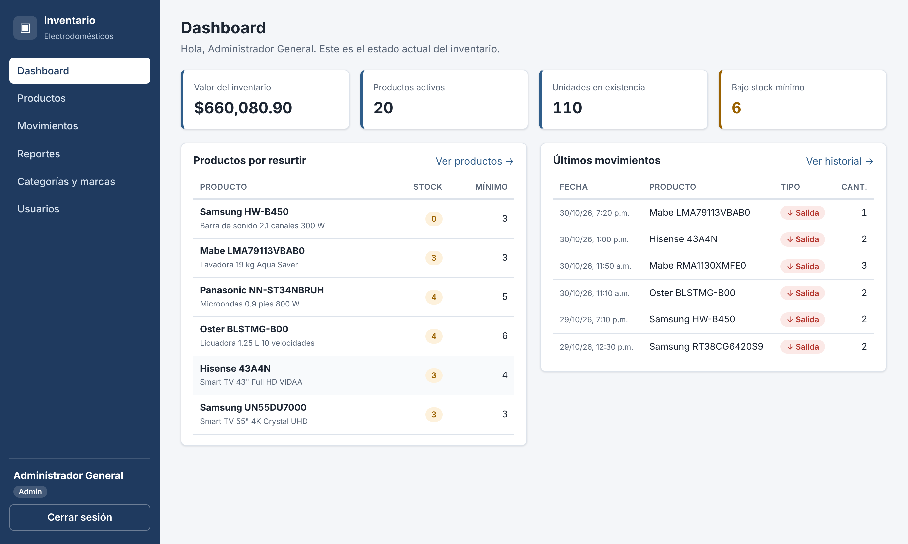

# Sistema de Inventario — Reingeniería de software

Reingeniería del *Inventory Management System* (Visual Basic 6 + MS Access) a una aplicación web moderna: **React + Node.js (Express) + MySQL 8**.

Proyecto académico del tercer parcial: Facultad de Ingeniería, Universidad Autónoma de Chihuahua.



---

## Descargar y ejecutar (la forma fácil)

1. Ve a **[Releases](../../releases/latest)** y descarga el archivo de tu sistema:
   - Windows: `inventario-…-windows-x64.zip`
   - Linux: `inventario-…-linux-x64.tar.gz` (o `linux-arm64` para Raspberry Pi y similares)
2. Descomprímelo.
3. Ejecútalo:
   - **Windows:** doble clic en `inventario.exe`. Si sale "Windows protegió su PC", da clic en *Más información* → *Ejecutar de todas formas* (el ejecutable no está firmado).
   - **Linux:** en una terminal, dentro de la carpeta: `./inventario`

La primera vez pregunta los datos de conexión a MySQL. Después crea la base de datos con datos de ejemplo y abre el navegador en `http://localhost:3000`. **No hace falta instalar Node.js ni correr scripts SQL.** El único requisito es tener un servidor MySQL o MariaDB encendido.

| Rol | Correo | Contraseña |
|---|---|---|
| Admin | admin@inventario.local | Admin123* |
| Almacén | almacen@inventario.local | Almacen123* |

### Opciones

    inventario --reset        Borra la base de datos y la deja como recién instalada
    inventario --configurar   Vuelve a pedir los datos de conexión a MySQL
    inventario --puerto 8080  Usa otro puerto web
    inventario --no-abrir     No abre el navegador
    inventario --ayuda        Todas las opciones

Los datos de conexión se guardan en `inventario.env`, junto al ejecutable.

---

## Instalar MySQL (si no lo tienes)

Funciona con **MySQL 8.0.16+** o **MariaDB 10.6+**.

| Sistema | Instalar y encender |
|---|---|
| Windows | [MySQL Installer](https://dev.mysql.com/downloads/installer/) → *Custom* → MySQL Server 8.0 (anota la contraseña de root). También sirve [XAMPP](https://www.apachefriends.org/). |
| Ubuntu / Debian / Mint | `sudo apt install mysql-server` |
| Fedora | `sudo dnf install mariadb-server && sudo systemctl enable --now mariadb` |
| Arch / Manjaro | `sudo pacman -S mariadb && sudo mariadb-install-db --user=mysql --basedir=/usr --datadir=/var/lib/mysql && sudo systemctl enable --now mariadb` |
| openSUSE | `sudo zypper install mariadb && sudo systemctl enable --now mariadb` |
| macOS | `brew install mysql && brew services start mysql` |

### Linux: el usuario root

En casi todas las distros, el `root` de MySQL/MariaDB solo entra con `sudo` (autenticación por socket), así que **ninguna contraseña le funciona a una aplicación**. Crea un usuario para el sistema:

```bash
sudo mysql -e "CREATE USER IF NOT EXISTS 'inventario'@'localhost' IDENTIFIED BY 'Inventario123*';
CREATE USER IF NOT EXISTS 'inventario'@'127.0.0.1' IDENTIFIED BY 'Inventario123*';
GRANT ALL PRIVILEGES ON *.* TO 'inventario'@'localhost';
GRANT ALL PRIVILEGES ON *.* TO 'inventario'@'127.0.0.1';
FLUSH PRIVILEGES;"
```

Luego, en el asistente, usa el usuario `inventario` con la contraseña `Inventario123*`. Si se te olvida, el propio programa te muestra este comando cuando root es rechazado.

> El usuario necesita permisos globales, no solo sobre `inventario_web`. MySQL 8 tiene el binlog activado y, en ese caso, crear triggers exige privilegios de administrador.

---

## Correr desde el código fuente

Requisitos: **Node.js 20 o superior** y MySQL encendido.

```bash
git clone https://github.com/BraulioP-ai/inventario-reingenieria.git
cd inventario-reingenieria
npm install     # instala backend y frontend y compila el frontend
npm start       # pregunta la conexión a MySQL la primera vez y crea la BD
```

Abre `http://localhost:3000`. La configuración queda en `backend/.env` (puedes partir de `backend/.env.example`).

> **Linux:** el `nodejs` de los repositorios de algunas distros es viejo (Ubuntu 24.04 trae la 18). Instala una versión actual con [nvm](https://github.com/nvm-sh/nvm) (`nvm install 22`) o con [NodeSource](https://github.com/nodesource/distributions), o usa el ejecutable.

> **Windows:** si acabas de instalar Node y PowerShell no reconoce `npm`, cierra la ventana y abre otra.

| Comando | Qué hace |
|---|---|
| `npm start` | Arranca el sistema (API + frontend compilado) |
| `npm run dev` | Backend con recarga automática |
| `npm run dev:frontend` | Frontend con Vite en `http://localhost:5173` (usa el backend en el puerto 3000) |
| `npm run build` | Compila el frontend |
| `npm test` | 16 pruebas de integración de la API (necesita la BD con los datos de ejemplo) |
| `npm run ejecutables` | Genera los ejecutables en `dist/` |

### Generar los ejecutables

```bash
npm run ejecutables                     # Windows x64 y Linux x64
npm run ejecutables -- linux-arm64      # otros destinos: windows-x64, linux-x64, linux-arm64
```

Empaqueta backend, frontend y scripts SQL en un solo archivo con [esbuild](https://esbuild.github.io/) y lo convierte en ejecutable con [pkg](https://github.com/yao-pkg/pkg), que ya incluye Node.js.

GitHub Actions corre las pruebas contra MySQL 8 en cada push. Para publicar una versión nueva, sube el número de `version` en el `package.json` de la raíz (por ejemplo a `1.0.1`) y haz push a `main`: Actions genera los ejecutables, crea la etiqueta `v1.0.1` y los publica en Releases. Subir una etiqueta `v*` a mano hace lo mismo.

---

## Estructura

    bd/          Scripts SQL (esquema + datos de ejemplo) y diagramas ER
    backend/     API REST: Node.js + Express + mysql2
      src/arranque/   Asistente de configuración, instalación automática de la BD y diagnóstico de errores
    frontend/    Interfaz: React + Vite
    scripts/     Construcción de los ejecutables
    docs/        Capturas de pantalla para el manual de usuario

## Del sistema legacy al nuevo

| Sistema original (VB6 + Access) | Reingeniería |
|---|---|
| 2 tablas sin llaves; categoría y marca repetidas como texto | 5 tablas en 3FN con PK, FK, UNIQUE y CHECK |
| Ruta del `.mdb` escrita en el código | Configuración externa (`.env`) |
| SQL armado concatenando texto (inyección SQL) | Consultas parametrizadas |
| Lógica dentro de los formularios | Capas: interfaz → API → servicios → BD |
| Sin usuarios | Login con JWT, contraseñas bcrypt, roles Admin / Almacén |
| Stock editable a mano | El stock solo cambia por movimientos (triggers) y nunca queda negativo |
| Costo total guardado como texto | Se calcula al consultar (vistas) |
| Solo Windows XP | Navegador web; servidor en Windows, Linux o macOS |

Más detalle en [`bd/README.md`](bd/README.md) (modelo de datos) y [`backend/README.md`](backend/README.md) (endpoints).

## Problemas comunes

| Mensaje | Causa y solución |
|---|---|
| *MySQL no está encendido* (`ECONNREFUSED`) | Enciende el servicio: `net start MySQL80` (Windows, como administrador), *Start* en XAMPP o `sudo systemctl start mysql` / `mariadb` (Linux). |
| *MySQL rechazó el usuario* (`ER_ACCESS_DENIED_ERROR`) | Contraseña incorrecta. En Linux con root, ver [arriba](#linux-el-usuario-root). |
| *no tiene permisos para crear la base de datos y sus triggers* | El usuario necesita `GRANT ALL PRIVILEGES ON *.*`. |
| *El puerto 3306 es el de MySQL* | En la configuración, `PORT` es el puerto web (3000), no el de MySQL. |
| Linux: `Permission denied` | `chmod +x inventario` |
| `'npm'` o `'node'` no se reconoce | Abre una terminal nueva después de instalar Node.js. |
